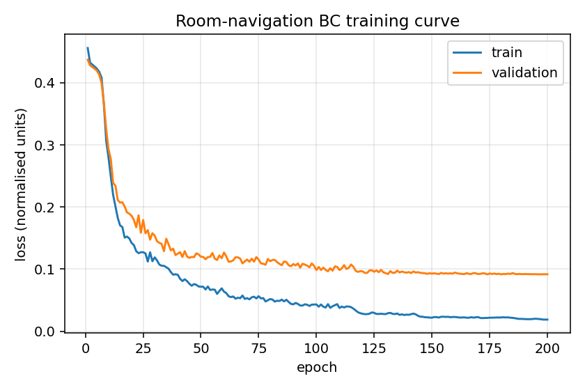
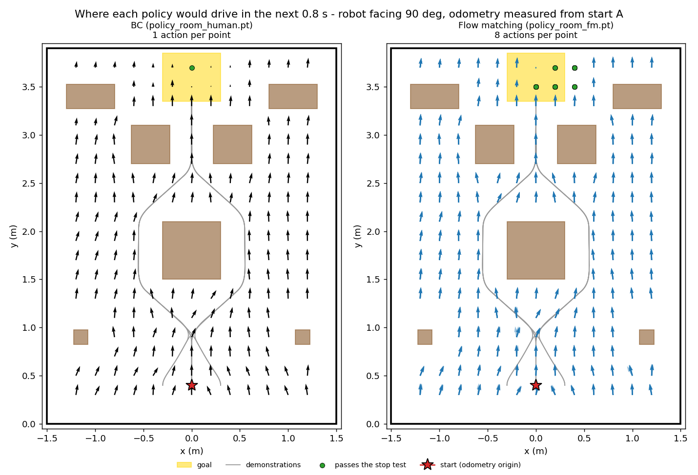

# Assignment 4 — Report

**Name:**
**Roll number:**

<!-- Figures go in figures/ and are embedded with relative paths:
     
     Test results go in Markdown tables. Delete these comments. -->

## Part 1 — Behavioural Cloning

**Demonstrations recorded:**

| Start | Success | Collided | What was hit |
|---|---|---|---|
| E | /3 | /3 | |
| F | /3 | /3 | |

How the failed trials failed:

## Part 2 — DAgger

| Policy | Human-labelled samples | of which DAgger corrections | Test success |
|---|---|---|---|
| Part 1 BC | | 0 | /6 |
| DAgger round 1 | | | /6 |
| DAgger round 2 | | | /6 |

How much extra labelled data DAgger needed, compared with Part 1:

## Part 3 — Flow Matching

| Start | Success | Collided | What was hit |
|---|---|---|---|
| E | /3 | /3 | |
| F | /3 | /3 | |

### Q3.1

### Q3.2

(a)

(b)

## Part 4 — Policy Gradient (REINFORCE)

### Q4.1

### Q4.2

### Q4.3
