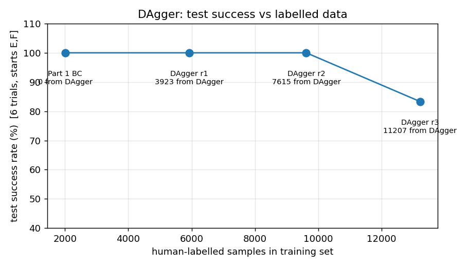
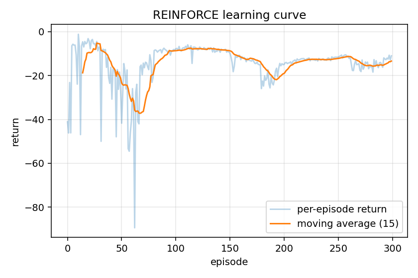
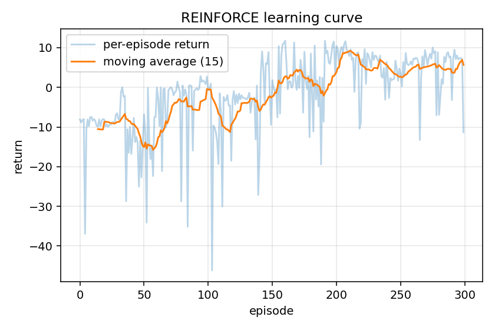

# Assignment 4 — Report

**Name:** Dheeraj Kumar Mishra
**Roll number:** 25M1066

> **Disclosure.** Code and report were prepared with the help of an AI coding assistant (Claude). The demonstrations (Part 1) and the DAgger corrections (Part 2) were **not driven by hand**. They were produced by the course's scripted expert (`expert_demo_room.py`) through a wrapper, `tools/a4_auto.py`:
>
> - **Demos:** every demo ends with 2 s of recorded `v = w = 0` inside the goal, as a person pressing ENTER only after stopping would.
> - **DAgger:** the wrapper uses the same expert as an automatic HG-DAgger supervisor. It takes over when clearance < 0.12 m or the policy's turn rate differs from the expert's by > 1.2 rad/s, and hands back after 1 s of agreement. Only supervisor steps are labelled `human=True`.
>
> Everything else (dataset building, training, testing) used the provided scripts unchanged.

## Part 1 — Behavioural Cloning

**Demonstrations recorded:** 8. These are the 4 `train` starts (A–D) × both sides of the island, all ending stopped inside the goal. That gives 2,007 samples, split by episode into 1,002 train and 1,005 validation.

*Training (L1) loss falls steadily; best validation loss 0.091 (normalised units).*

| Start | Success | Collided | What was hit |
|---|---|---|---|
| E | 3/3 | 0/3 | – |
| F | 3/3 | 0/3 | – |

How the failed trials failed: none failed. All 6 trials ended `stopped` inside the goal, with the closest approach to any obstacle +0.061 m (mean +0.070 m). Even though left and right demos are balanced, the policy does not average them into the island. The start offsets (E at x = +0.15, F at x = −0.15) and the image make the side choice a function of the observation, so the regression head commits to one side (see the BC field in Part 3).

## Part 2 — DAgger

| Policy | Human-labelled samples | of which DAgger corrections | Test success |
|---|---|---|---|
| Part 1 BC | 2,007 | 0 | 6/6 |
| DAgger round 1 | 5,930 | 3,923 | 6/6 |
| DAgger round 2 | 9,622 | 7,615 | 6/6 |
| DAgger round 3 | 13,214 | 11,207 | 5/6 (1 collided with the island, start F) |

Each round ran 5 trials from each of the 4 train starts (20 episodes). The supervisor's intervention rate fell from 78.6% (round 1) to 75.2% (round 2) to 72.6% (round 3).

*Test success rate (6 trials on starts E/F) against the number of human-labelled training samples. Each point is annotated with how many of those samples came from DAgger corrections.*

How much extra labelled data DAgger needed, compared with Part 1: none was needed to *change* the success rate here. The Part 1 policy was already 6/6 on the test starts, so the first two rounds (+3.9k and +7.6k corrected samples, 3–5× the original demonstrations) kept it at 6/6 without improving it. Round 3 (+11.2k) dropped to 5/6. The aggregated set became dominated by recovery data from states far from the nominal paths, and with 6 trials one collision is within noise. DAgger's benefit is robustness in states the demos never visit (see Q3.2b), which this small test set does not measure. Our automatic supervisor was also stricter than a person would be (≈ 75% intervention), so it relabelled many states where the policy was already acceptable.

## Part 3 — Flow Matching

`fm_losses.py` self-check passes: 98% of samples land near the ±1 modes of the bimodal toy and 1% near the mean.

| Start | Success | Collided | What was hit |
|---|---|---|---|
| E | 0/3 | 0/3 | – |
| F | 0/3 | 0/3 | – |

All 6 trials ended in **timeout**: the robot reached the goal region but never satisfied the stop test (|v| < 0.01 m/s and |w| < 0.05 rad/s for 1.5 s).

### Q3.1

No, flow matching got 0/6 against BC's 6/6, and not because it drives worse. In the runs the FM policy travels around the island and into the goal box as well as BC does, without any collision. It then keeps creeping and twitching instead of stopping, so every trial times out. Success requires the robot to be *stopped* for 1.5 s. Flow matching samples a fresh action from noise every step. Inside the goal, the demonstrated action distribution is "exactly zero", but a sampled action is only *near* zero: small residual v and w from the noise and integration error easily exceed 0.01 m/s and 0.05 rad/s. BC's regression head outputs the conditional mean, and since every goal sample in the demos is exactly 0, it outputs ≈ 0 and passes the stop test. Expressiveness is the problem here: an exact, deterministic action is the hardest thing for a stochastic generative policy to reproduce.

### Q3.2

(a) **Along the demonstration paths** both policies point the robot along the grey routes, around the island and up through the gap. **Inside the goal box** they differ. BC's arrows shrink to (almost) zero length, which is a stop, and the green dots show it passes the stop test there. FM's 8 sampled actions per point are still clearly non-zero, pointing forward, so FM keeps moving. Its green "passes the stop test" dots are only isolated points. The field shows directly why FM fails the success criterion in Q3.1 while BC meets it.

(b) **Far from the demonstrations** (along the side walls, x ≈ ±1.2) both policies still output confident "drive forward/up" arrows, including straight towards the shelves at y ≈ 3.4. Neither turns toward the gap or slows near the walls, so these arrows are not sensible. A learned policy has no notion of "I have never seen this state". It extrapolates whatever its function does nearby, and FM's 8 samples agree with each other, so they look just as confident as BC there. This is the covariate-shift problem DAgger targets: by letting the policy drive into such states and labelling the correct action there, DAgger adds training data exactly where the policy goes off the demonstrated distribution.

## Part 4 — Policy Gradient (REINFORCE)

Two full runs of 300 episodes each from start `centre`, odometry-only Gaussian policy. Files: `policy_pg_progress.pt`, `logs/pg_episodes_progress.csv`, `figures/pg_training_curve_progress.png`, and `policy_pg_euclid.pt`, `logs/pg_episodes_euclid.csv`, `figures/pg_training_curve_euclid.png`.

### Q4.1

Both designs share these terms (`compute_reward`, flags `--reward-*`):

| Term | Value | Purpose |
|---|---|---|
| Progress shaping | +10 per metre of reduction in "distance still to go" (difference between consecutive steps) | A dense signal so random early policies already see which way is better. Being a difference of a potential, it cannot be farmed by oscillating. |
| Time cost | −0.01 per step | Prefer finishing sooner over dawdling. |
| Proximity penalty | up to −0.5 per step, growing linearly as clearance drops below 0.10 m | Teach "stay away from things" before the hard collision signal. |
| Goal | +20 on entering the goal region | The actual objective. |
| Collision | −10 | Terminal failure. |
| Stall / timeout | −5 | Discourage simply parking. |

The two runs differ only in how "distance still to go" is measured:

- **Design A, `progress`:** the distance **along a route around the island**: from the robot to a via-point beside the island on whichever side the robot is currently on (x ≥ 0 → right), then on to the goal. Both sides score equally, and progress never asks the robot to go *through* the island.
- **Design B, `euclid`:** the straight-line distance to the goal centre. It is simpler, but the direction of steepest progress points straight through the island.

### Q4.2

*Design A. Episode return vs training episode, per episode and 15-episode moving average.*

*Design B. Same axes.*

Using the episode logs (outcome and length):

- **Design A.** In episodes 0–30 the near-random policy wanders for ~237 steps and usually ends by brushing an obstacle (return ≈ −12). In episodes 30–70 return *drops* to ≈ −27: the policy drives forward more decisively and spends long stretches close to the island, collecting the per-step proximity penalty before colliding. In episodes 70–300 episodes shrink abruptly to **~81 steps (8 s)**, every one a collision. Return recovers to a plateau of ≈ −9 to −16. The policy has learned to drive straight ahead quickly and hit the island: it banks the progress reward for the first ~1.3 m, pays −10 once, and avoids the slowly accumulating proximity, time and stall penalties. It never reached the goal.
- **Design B.** Early episodes nearly all time out (~397 steps) with return ≈ −10, which is the timeout penalty plus little progress. Over training the collisions fall from 14 to 5 per 50 episodes and the return rises steadily to **+5 to +10** (episodes 200–300), still mostly via timeouts. The policy learned to drive up to the face of the island, the closest point to the goal on the straight line, and stay there for the rest of the 40 s without touching it. It never reached the goal either.

### Q4.3

Yes, in both runs.

- **Design A found "die early".** A shaping reward with a per-step proximity penalty and a bounded collision penalty makes a fast crash cheaper than a long careful episode. Hitting the island after 8 s costs less than threading the gap while being charged up to −0.5 per step near walls. What I would change: make the collision penalty larger than the most negative reward a successful run could accumulate (for example −50), and charge proximity only *on top of* progress, not as a cost that grows with episode length.
- **Design B found "park in front of the obstacle".** With straight-line shaping, the global minimum of "distance to go" reachable without collision is directly in front of the island. Going around requires *losing* reward first (moving sideways and away). REINFORCE, following its local gradient, settles in that local optimum and simply waits for the timeout. The −5 timeout penalty was smaller than the progress already banked, so parking is profitable.

What I changed between the runs: design B is the naïve reward, and design A was the fix for its local-optimum problem (route-aware progress, so going around the island is never penalised). Design A removed parking but exposed the second exploit. The next iteration would combine design A's route-progress with a much larger collision penalty and a small bonus for passing the via-point. Plain REINFORCE with 300 episodes and no baseline other than return normalisation explores too little to discover the +20 goal bonus by chance, so the dense shaping terms entirely determine what is learned.
